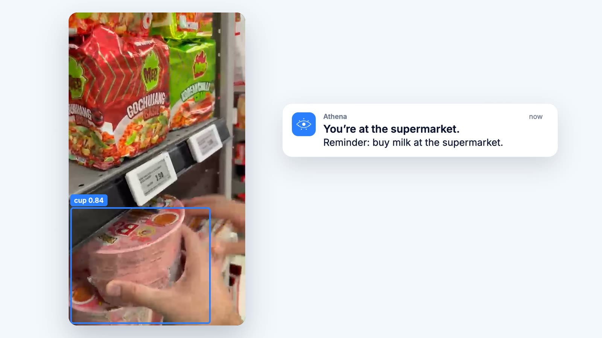
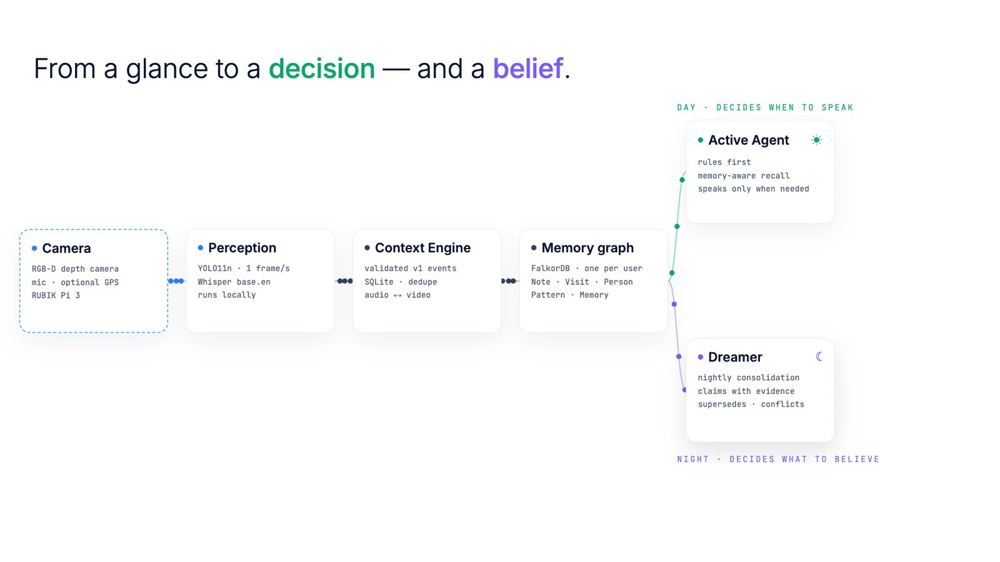
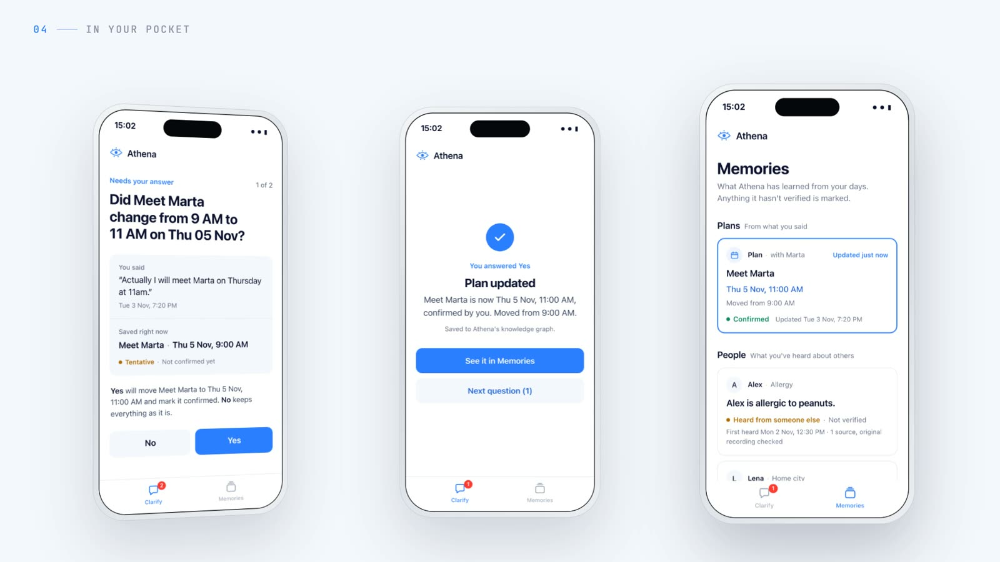

# Athena

**A wearable that sees what you see, remembers what matters, and only speaks up when it should.**

We wanted a memory aid that behaves like a thoughtful friend, not a recorder. Athena is a small
camera you clip on. It builds a graph of your days from what it sees and hears, decides in real
time whether anything is worth telling you (usually it isn't), and every night it "dreams":
it replays the day against everything before it and only then decides what to believe.

**▶ [Watch the 3-minute demo](https://youtu.be/ZgWDbSlrJaE)**

[](https://youtu.be/ZgWDbSlrJaE)

## How it works

A camera and mic feed two small local models: YOLO11n looks at one frame per second and Whisper
transcribes speech. The Context Engine validates and aligns those events, and everything lands in a
FalkorDB graph, one per user. Every note, visit and belief keeps a link to the recording it came
from, so Athena can always tell you *why* it thinks something.

During the day the **Active Agent** reads that graph and decides whether to speak. It is rules
first and mostly quiet: in a simulated 9-hour day, 30,420 frames turned into 7 notifications. It
also cares about who said what. If a friend says "I have class at 6", that's their plan, not
yours, and things you only heard about stay marked as not verified.

At night the **Dreamer** goes through the day in four rounds (routines, places, people, then
consolidation) and writes patterns and long-term memories. One visit to a clinic stays an anomaly;
a routine needs several separate days. When you correct something, the old fact is superseded,
not deleted, and when Athena isn't sure, it asks you before changing anything.



## The app

> **Quick look, no install: [static preview of the app screens](https://meta-hackathon-athena.github.io/athena/).**
> This is not the running system. It is the app's interface on a saved copy of the demo data, so you
> can click through it without cloning anything. Nothing runs behind it: no agent, no Dreamer, no
> Muse, and answers aren't saved. To see Athena actually work, clone the repo and follow
> [Run it](#run-it-about-5-minutes) below (about 5 minutes).

The app is the phone side of the wearable. We built it as a mobile-first web app so anyone can open
it without an app store. It has two screens: **Clarify** (Athena's yes/no question, the words that
raised it, and what "Yes" will change) and **Memories** (what Athena believes, and how much it
trusts it). Run locally, both read the live backend.



## Run it (about 5 minutes)

You need [`uv`](https://docs.astral.sh/uv/getting-started/installation/) (it installs Python 3.12
for you), Node 18+ and `make`. Docker is optional. The code and CLI still use the working name
`vixy`.

```bash
git clone https://github.com/meta-hackathon-athena/athena.git && cd athena
./scripts/bootstrap.sh --no-docker      # or `make install` if you have Docker (then drop FALKORDB_URL= below)
```

### 1. Watch a simulated run in the terminal

Two synthetic days go through the whole pipeline: events, the Active Agent's live decisions, the
Dreamer overnight, then questions to `/ask`, each answer traced back to the original event. With a
Muse key in `.env` the Dreamer also does a Muse pass, which takes about three minutes.

```bash
make ui-demo VIXY_USER=app_demo FALKORDB_URL=
```

```text
3. restart (new runtime process state); the simulated clock moves to Day 2 (Tue 3 Nov)
   Tue 17:17:20  NOTIFY  done        You're at the supermarket. Reminder: buy milk at the supermarket
   Tue 17:20:03  NOTIFY  done        Someone mentioned yesterday that Alex is allergic to peanuts. I haven't verified it. …
   Tue 17:30:03  NOTIFY  suppressed  Someone mentioned yesterday that Alex is allergic to peanuts. …
   Tue 19:00:03  NOTIFY  done        Someone mentioned yesterday that Marta has a presentation on Thursday 5 Nov at 09:00. …
…
   Q: What did Marta tell me about the presentation?
   A: [answered] I can't identify speakers by name, so I can't confirm it was Marta who said it. …
    source Note note_7e7ea96f6e51a2b5 … ✓ text + sha256 match the original event
18/18 checks passed
```

### 2. Use the app

```bash
make serve VIXY_USER=app_demo FALKORDB_URL=     # API on http://127.0.0.1:8765/v1   (terminal 1)
make web                                        # app on http://127.0.0.1:5173      (terminal 2)
```

Open <http://127.0.0.1:5173> in a phone-sized window, answer the question, then open Memories.
Or ask from the terminal:

```bash
uv run python -m vixy --user app_demo --state-dir data/app_demo ask "What do you remember about Alex?"
```

### 3. Optional: real video through the real models

`make install-perception` adds YOLO11n and Whisper (a few GB, needs `ffmpeg`), and `make smoke-av`
(needs Docker) generates two short MP4s, runs them through perception and replays them into the backend. To replay
your own recordings, see [demo/README.md](demo/README.md).

## Local first, Muse for the hackathon

Athena is meant to run on hardware you own. Your day is the most private data there is, so the
parts that watch and react in real time (perception and the Active Agent) are small, rules-first
and built to run on a pocket board (target: RUBIK Pi 3, Qualcomm QCS6490) with nothing leaving it.

The part that needs real reasoning, the Dreamer, runs on **Meta Muse** (`muse-spark-1.3`) for this
hackathon. Each night it runs four focus rounds over the graph (routines, places, people, then
consolidation), reading with read-only Cypher and writing only through validated tools, so every
pattern and memory it stores links back to its evidence. Put your key in `.env` as
`MODEL_API_KEY=...` and `make ui-demo` dreams on Muse automatically; to run it again:

```bash
uv run python -m vixy --user app_demo --state-dir data/app_demo dream --online
```

Without a key, everything still runs, with the Dreamer's offline rules.

## Repository

```text
vixy/          runtime, CLI, /v1 API, perception and replay
agent/         Active Agent (rules, recall, questions)
memory/        graph memory and schema
components/    context-engine/, dreamer-model/
frontend/web/  the Athena app (no build step, Node built-ins only)
demo/          MP4 simulator
docs/          architecture, API, graph schema, reports
```

More detail: [architecture](docs/ARCHITECTURE.md) · [graph schema](docs/GRAPH_SCHEMA.md) ·
[API](docs/API.md) · [app integration](docs/FRONTEND_INTEGRATION.md) · [simulator](demo/README.md).

The API has no authentication and binds to `127.0.0.1`, so keep it local.
